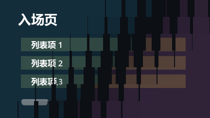
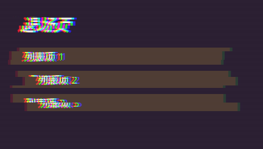

# 双页与组件动效

固定场景里的位移、缩放、透明度与颜色可以直接在 Godot 的 Animation 面板分别打关键帧。运行时才知道偏移量、时长或目标时，原生 Tween 可以并行驱动这些属性。横飞与斜飞共用一个位移向量，叠加淡出只需再动画透明度。[Godot 动画轨道](https://docs.godotengine.org/en/stable/tutorials/animation/introduction.html) · [Godot Tween](https://docs.godotengine.org/en/stable/classes/class_tween.html)

跨页面复用编排时，启用 `gf.action_queue`，打开 GF 工作区的 **开始制作 → 界面动效**。工作台从空配方开始，也可拖入自己的资源。点击 **添加属性轨道**，用原生 Inspector 设置目标、属性、起止值和时间。点击 **播放** 重新绑定当前参数，或拖动时间条检查姿态。**另存项目配方**将当前组合写入项目的 `.tres`。

例如让任意旧页向左上方飞出并淡出，可添加两条时钟均为 `EXIT`、目标均为 `outgoing` 的属性轨道。

| 属性 | 起点 | 终点 | 单位 |
|---|---|---|---|
| `position` | `Vector2.ZERO` | `Vector2(-1, -0.3)` | 打开 `relative` 和 `in_parent_units`，分别为父区域宽、高的倍数 |
| `modulate:a` | `1.0` | `0.0` | 透明度 |

把第一行的终点改成 `Vector2(-1, 0)` 就会水平飞出。两条轨道沿用默认相对时长时，改配方的 `exit_seconds` 会同时改变这段飞出和淡出的时长。各轨也可独立设置延迟和缓动。单独编辑退场时样机会把旧页放在前面。两页一起编辑时，可以在工具栏切换“旧页在前”或“新页在前”，在同一时刻检查两张页面。

## 绑定真实显示对象

`GFUIMotionRecipe` 保存两页的时长和 `GFUIMotionTrack` 资源。每个轨道指定具名目标及参考时钟，可以附带效果或触发标记。调用方可以把同一个页面放入不同导航流程，在每次播放时指定节点、集合和项目输入。

```gdscript
var error := player.play(recipe, {
    &"outgoing": old_page_wrapper,
    &"incoming": new_page_wrapper,
    &"rows": visible_rows,
    &"meter": display_bar,
    &"decode": readout,
})
if error != OK:
    push_warning(player.get_diagnostic())
```

这里的 `player` 是已入树的 `GFUIMotionPlayer`。目标名由配方和项目约定，只需传入实际用到的绑定。给受 Container 排版的内容准备独立的表现外层，容器继续管理占位。路由负责业务状态、输入、焦点、显示顺序及旧页释放。

新旧页分别有自己的时钟。新页的 `ENTER` 轨道设置 `at = 0.5` 会在入场一半时启动，改入场总长也会跟随。轨道可按秒或页时长的比例定义自己的时长，同一轨道绑定数组时使用 `stagger_seconds` 逐个错开。新页就位时发出 `page_entered`，更长的组件轨道仍可继续。取消会恢复 GF 属性轨道的基线。

### 用同一份配方接入 GF 路由

把播放器挂在导航宿主下。标准 UI 支持同步的 `push_route`、`back`、`replace_route`。项目只需给出这次导航操作和页面角色。下面三个调用共用同一份配方和绑定函数。

```gdscript
func navigate(operation: Callable) -> Error:
    var present := player.play_transition.bind(recipe, bind_roles)
    return ui.navigate_with_presentation(GFUIUtility.Layer.POPUP, operation, present)

func bind_roles(old: Control, page: Control) -> Dictionary:
    return {
        &"outgoing": old, &"incoming": page,
        &"rows": page.get_node("Rows").get_children(),
        &"meter": page.get_node("Meter"), &"title": page.get_node("Title"),
    }

# 菜单已经打开。项目可以在任一段动画中继续导航。
# navigate(router.push_route.bind(&"archive"))
# navigate(router.push_route.bind(&"settings"))
# navigate(router.back.bind(GFUIUtility.Layer.POPUP))
```

要清空该层历史并换页，传入 `router.replace_route.bind(&"settings")`。路由先提交栈和焦点，旧页暂时留在原画布上，仅供显示。播放器在最后一条使用旧页、子节点或声明了旧页节点输入的轨道结束时交还旧页。入栈时旧页恢复初始姿态并遵循层可见性。返回或替换时按原关闭策略回收。新页的列表和进度条继续走各自的时钟。快速再次导航会中断上一段表现。进入第一页或返回空栈时只执行导航。

这条交接路径只向前播放。页面打开失败会返回错误。自行传入导航回调时，成功返回到空栈应返回 `true`，与 `router.back()` 一致。项目用 `router.back(layer, false)` 保留旧面板时，可以在退场途中重新打开同一实例，先前的交还回调随即失效。页面已经打开但配方绑定失败时，导航保持已提交状态，旧页立即交还。异步资源加载可以在项目准备好页面后接入普通播放器，或沿用路由已有的异步导航阶段。

### 属性接管

默认情况下，两个界面播放器同时写同一目标的相交属性会得到 `ERR_BUSY`，原播放继续。需要显式接管时，在新的播放器上设置 `take_over_properties = true`。接管只停止冲突轨道，旧播放器之后取消也不会回写新值。普通属性可以分别写 `position:x` 和 `position:y`。受控 Tween 重建整组根属性，会占用整个 `position`。同一属性先淡入再淡出，可以直接复用原有多步骤 `GFTweenActionConfig`。项目效果需声明实际写入的全部属性，在 `REPLACED` 时释放临时资源并保留交接姿态。

### 启动页面已有的 AnimationPlayer

如果列表动画已保存在新页的 AnimationLibrary，在配方的 `tracks` 中新建一个 `GFUIMotionTrack`，将 `target` 设成 `incoming`，`clock` 选 `ENTER`，`at` 填 `0.5`，`cue` 填 `show_rows`，`effect` 留空。页面可以用自己的方法接收这个信号。

```gdscript
func _on_cue_reached(cue: StringName, target: Object) -> void:
    if cue == &"show_rows" and target == self:
        $AnimationPlayer.play(&"reveal_rows")
```

播放前把 `player.cue_reached` 连到该方法，并将页面自身绑定到 `incoming`。标记只在正向播放越过触发点时发出。页面拥有自己启动的剪辑，决定后续暂停和取消行为。需要反复定位重建的演出可以由配方直接采样属性，或由项目效果提供可采样绑定。普通的进度条可沿用 `Range.value`。实时业务读数和文字解码可以各自在控件上暴露一个 0 到 1 的表现进度。

## 组合轨道与材质

- `GFUIPropertyMotion` 调整目标的索引属性，例如 `position`、`modulate:a` 或项目自绘控件的进度。相对位移可以按真实父区域尺寸解释。一个会话内，每个对象的同一属性由一条轨道写入。
- `GFUILayoutMotion` 从输入的两份布局表中查找同一目标的实测矩形。将起点和终点转换到表现控件的同一父坐标系即可做共享元素和重排。
- `GFUITweenMotion` 接受已有 `GFTweenActionConfig`，用原有受控时间轴采样同一组步骤及曲线。
- `GFUIMaterialMotion` 把本次播放的材质实例应用到专用画布节点，驱动进度 uniform。纹理输入名由资源显式声明。直接推页、普通交叉淡化和纯色覆盖可以使用真实控件。需要像素的效果可传入实时 `ViewportTexture`，也可用宿主已经冻结的纹理。含活动子元素的页面保持实时。单屏遮罩也可使用[屏幕转场工具](../../standard/utilities/runtime/settings-ui-scene/scene-flow/switching-transition.md)。
- 内置的 `ui_motion/shaders/reveal.gdshader` 按像素决定新页何时显现。改 `direction` 可沿任意方向扫入，`softness` 控制过渡边缘的软硬。启用 `use_mask_texture` 后，`mask_texture` 的灰度从暗到亮决定出现的先后。`GradientTexture2D`、`NoiseTexture2D` 和自绘遮罩都可直接使用。
- 要加入项目自己的像素效果，把 `ShaderMaterial` 赋给 `GFUIMaterialMotion.material`，将 `progress_parameter` 设为 shader 的浮点进度参数名。如果要采样两页，在 `textures` 中把两个采样器名称分别映射到项目传入的纹理名。只画覆盖层的材质可以把 `textures` 留空，在真实页面上方的 `ColorRect` 播放。

工具样机提供 `outgoing`、`incoming`、`rows`、`title`、`meter`、`cover` 和双纹理合成的 `composite`。实际项目可使用任意目标名，真实绑定、布局数据与自定义效果可以在独立的真实页面对照工具中运行。当前配方及其引用决定播放时需要的资源。

### 可选动效素材库 {#ui-motion-assets}

把 `gf-ui-motion-assets-<version>.zip` 解压到 `project.godot` 旁。素材出现在 `res://addons/gf_ui_motion_assets/`，在 Godot 文件系统面板中即可选用。只用其中一个效果时，取对应的整个目录及包中的 `LICENSE.md` 即可。每个目录包含一个原生 ShaderMaterial、同目录的 shader 和它的 UID，不需要启用额外插件。

安装和游戏导出可以分别选择。两种素材都已安装时，Godot 的“导出所有资源”会将两者都放进游戏。选择“导出选定场景（及依赖）”并让配方直接引用网格翻片，导出的游戏就只带网格翻片。通过运行时拼接路径加载的材质，需要显式加入导出范围。

| 网格翻片 `tile_flip/tile_flip.tres` | 信号失真 `signal_distortion/signal_distortion.tres` |
| --- | --- |
|  |  |
| `grid` 决定行列密度，`flip_vertical` 改变翻转轴向，`stagger` 决定同时翻还是依次翻。`order_direction` 设置先后方向。想从中心扩散或按自绘图案翻，打开 `use_order_mask`，将灰度纹理赋给 `order_mask`。暗格先翻，亮格后翻。 | `band_height_pixels` 和 `band_shift_pixels` 控制条带高度和错位幅度，`channel_offset_pixels` 控制色差的方向和距离，`scanline_strength` 控制扫描线强度。色差设为零即可省去两次额外的纹理采样。`seed` 可更换条带图案。 |

在动效工作台中打开 **编辑配方**，在 Inspector 的 `tracks` 里添加 `GFUIMotionTrack`。将目标设为 `composite`，为 `effect` 新建 `GFUIMaterialMotion`，再把所选的 `.tres` 拖入它的 `material`。保留默认进度参数 `progress`，在 `textures` 字典中填写 `old_page → old_texture`、`new_page → new_texture`，就能播放或拖动样机时间条。

接入真实页面时，项目向这两个输入槽传入自己的 `Texture2D`，把 `composite` 绑定到覆盖两页的 `ColorRect`。两种材质都遵循节点的 `modulate`，可另加一条透明度轨道。每次播放会创建独立的材质实例。要保存自己的参数组合，可将材质另存到项目目录后再赋给轨道。

两个材质也可直接用于普通 Godot 画布节点，设置 `old_page` 和 `new_page`，再用 AnimationPlayer 或 Tween 将 `progress` 从 0 推到 1。框架基础包自带的方向／蒙版显现照常可用。项目自建的 ShaderMaterial 沿用同一接口。

## 接入项目效果

已有控件只需开放一个浮点属性，即可由属性轨道驱动。自定义算法可在工作区选择 **创建项目效果资源**。选择一个新的脚本名后，会在旁边生成同名的 `.tres`。把这个资源拖到轨道的 effect，就能编辑并复用它。导出参数沿用原生 Inspector。运行时直接引用项目资源，无需登记全局类型或编辑器插件。采用选定资源导出时，将完整 GF 插件、入口场景和演出脚本列入导出预设。场景显式引用配方，配方再引用项目自定义效果。

`GFUIMotionEffect.input_types()` 返回输入名与类型，支持内置 Variant 类型、原生类和项目 Script。`binding_error()` 可以检查目标、尺寸或项目数据。`bind_target()` 为每次播放创建新的 `GFUIMotionBinding`。在准备时读取基线，在采样时更新表现，在 release 中按 `GFUIMotionBinding.EndReason` 判断自然结束、立即完成或取消，并释放该次播放的临时资源。使用 `written_properties()` 声明会写入的属性，或提供一个专用表现节点。

已有模拟可将新建的 `GFVisualAction` 放入绑定的 `action` 字段。它在轨道开始时启动，按轨道有限区间接受暂停、恢复和结束。含这种动作的会话仅支持实播。若动作在运行时允许别的播放器接管属性，实现无参数的 `stop_at_current_pose()`，停止写入并保留当前画面。缺少该方法时，竞争播放返回 `ERR_BUSY`。能从相同输入和时间重建外观的效果提供 `sample`，即可用 `seek()` 定位。普通数值样机仍可使用[编辑器预览适配器](tween-numeric-preview.md)。

真实场景在独立的编辑器工具里采样。操作和项目钩子见[真实页面对照](../../editor/tools/ui-review.md)。
